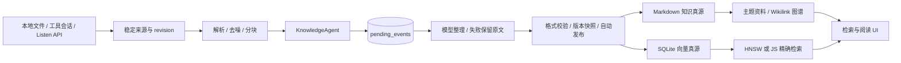

# Auto-Memories-Doll

本地优先的知识整理 Agent。它观察 Markdown、文本和开发工具会话目录，把有效来源消息自动保存为可检索、可追溯的 Markdown 知识与主题学习资料。

这不是聊天产品。项目不提供聊天会话、用户画像、人格 Prompt、聊天型 MCP/Skills 或浏览器历史采集。

## 核心链路



当前策略（LKA-004）：所有格式有效的非空消息自动入库，不再以质量评分、长度或语义相似度拒绝发布，也不需要人工审核。未变化来源不会重复入队；不同来源的相同正文可以分别保存。候选先进入持久化队列，再按同一记忆 ID 串行发布；更新保留版本快照。模型整理失败时保存完整原文，Embedding 不可用时仍可发布并使用关键词检索。

Codex 来源只采集真实用户输入和每轮最终回答；尚未完成的轮次继续等待，推理、工具事件和进度消息不作为对话知识入库。主题资料引用知识 ID 与来源版本，支持回溯原始依据。

## 本地运行

前置要求：Node.js 22+、npm 10+。模型凭证可选；无凭证时仍可采集、保存原文、浏览和进行关键词检索。

下载仓库并进入项目目录：

```bash
git clone https://github.com/DA-cpu1/Auto-Memories-Doll.git
cd Auto-Memories-Doll
npm ci
```

macOS / Linux：

```bash
cp .env.example .env.local
npm run dev
```

Windows PowerShell：

```powershell
Copy-Item .env.example .env.local
npm run dev
```

打开 [本地首页](http://127.0.0.1:3000)。服务只绑定回环地址，API 拒绝非本机 Host 请求。生产运行使用 `npm run build`，构建成功后执行 `npm start`；生产环境不要将 `NODE_ENV` 固定为 `development`。

最小配置：

```env
MEMORY_ROOT=./memory-root
VECTOR_BACKEND=hnsw
```

模型与 Embedding 在 `/settings/ai` 分别配置：普通模型用于话题分类，旗舰模型用于知识卡片整理，廉价模型用于查询改写；Embedding 可独立关闭，并配置独立端点、模型和维度。设置页保存的配置存于本地 SQLite。当前模型运行路径读取 SQLite 配置，`.env.local` 中的 `MODEL_*`、`FLAGSHIP_MODEL`、`STANDARD_MODEL`、`BUDGET_MODEL` 和 `EMBEDDING_MODEL` 不会自动导入或覆盖它；启用模型时请在设置页填写端点、凭证和模型并保存。更换 Embedding 模型时需同步维度并重新生成向量。

来源目录在 `/settings/tools` 管理；笔记目录可在 `/settings/storage` 迁移，数据库始终留在 `MEMORY_ROOT` 指定的位置。完整环境变量见 [.env.example](.env.example)。

## 使用流程

1. 在“来源设置”新增 Markdown、Text、Codex、Claude Code、Cursor 或 Trae 目录。
2. 等待 watcher，或点击“扫描所有来源”。
3. 在状态页查看来源版本、事件进度和耗时，以及排队、处理中、完成、失败、等待服务等状态。
4. 等待后台自动发布；入队不代表已经写入 Markdown，以完成状态和检索结果为准。
5. 在检索库使用关键词、向量、标签、查询改写、图谱邻居和 MMR 重排。
6. 打开主题资料，沿知识链接与来源版本追溯原始依据。

外部工具也可以向 `POST /api/listen` 发送类型化会话：

```bash
curl -X POST http://127.0.0.1:3000/api/listen \
  -H "Content-Type: application/json" \
  -d '{
    "source": "local-tool",
    "messages": [
      {"role": "user", "content": "为什么来源版本必须稳定？"},
      {"role": "assistant", "content": "稳定 revision 让重复扫描成为无操作。"}
    ],
    "topic": "learning"
  }'
```

`/api/listen` 接收成功后返回 `memoryId`、话题和知识卡片；`filePath` 是目标路径，后台队列完成后才代表发布成功。接口单次最多接收 200 条消息，请求体上限为 1,000,000 字节。需要持续更新同一会话时，在 `metadata.conversationId` 或 `metadata.sessionId` 中传入稳定标识。

## 存储与隐私

```text
memory-root/
├─ memory.db                  # 队列、来源版本、向量真源和配置
├─ memory.db.ann-*.usearch    # 可重建的 HNSW sidecar
├─ notes/{topic}/{id}.md      # 规范知识
├─ guides/{topic}.md          # 带引用的主题学习资料
└─ archive/                   # 审计、失败与版本记录
```

- Markdown 是人类可读的知识真源；SQLite 保存事务状态与向量记录。
- 本地文件只有在配置远程模型后才会发送必要片段，发送前执行密钥模式脱敏。
- 当前模型 API Key 保存在本地 SQLite 配置中，不应提交凭证或数据库到 Git。
- 旧聊天、画像和 MCP/Skills 数据不会被运行时读取，也不会被迁移过程主动删除。

## 故障行为

| 故障 | 行为 |
| --- | --- |
| LLM 不可用或输出非法 | 整理失败时自动保存完整原文；恢复后的新任务继续使用模型，已保存原文不会自动改写 |
| Embedding 关闭或不可用 | 不阻塞发布，搜索退回关键词；启用并恢复后后台补建缺失向量 |
| 来源未变化 | 返回 unchanged/no-op，不创建副本 |
| 进程在 processing 中断 | 原事件恢复，attempt 递增后重试 |
| Markdown 写入或 schema 校验失败 | 保留失败上下文，不静默覆盖 |
| HNSW 缺失、损坏或版本不一致 | 从 SQLite `vector_records` 自动重建；失败时用 JS 精确后端 |
| 主题资料引用非法 | 拒绝新版本并保留上一份合法资料 |

首页的模型提示读取当前健康状态，按槽位显示模型、原因、发生时间和耗时；历史失败记录不代表当前仍在故障。设置页的连接测试只验证表单中普通模型的基础连通性，不能代表所有模型槽位均可用。

升级时，旧人工审核、质量/抽取等待及关联的挂起冲突会按原事件身份恢复到自动处理队列；历史终拒记录不会自动重新发布。人工审核页面与 `/api/audit` 系列接口已删除。更新策略和迁移边界见 [LKA-004 交付记录](docs/specs/004-automatic-publishing/delivery.md)。

## 重建

- 重扫来源：在 `/settings/tools` 点击“扫描所有来源”，或 `POST /api/listen/scan`。
- 重建既有知识任务：在 `/memory` 点击“全量扫描重建”，或 `POST /api/memory/rebuild`。
- 重建主题资料：打开 `/memory/topic/{topic}` 点击“刷新资料”；API 为 `POST /api/topics/{topic}`，请求体 `{"modelAssist":false,"force":true}`。
- 重建 HNSW：停止服务，删除对应的 `memory.db.ann-{dimensions}.usearch` sidecar 后重启。SQLite 向量真源和 Markdown 不会被修改。

不要删除 `memory.db` 来“重建索引”，它包含队列、来源版本与向量真源。

## 工程验证

```bash
npm run format:check
npm run typecheck
npm run lint
npm run audit:dead-code
npm run test:coverage
npm run eval
npm run build
npx playwright install chromium
npm run test:e2e
```

检索评测使用 26 条记忆和 38 条查询，覆盖精确、关键词、口语、含噪、同义词、主题过滤和近似重复场景。阈值与最新报告由 `npm run eval` 生成到 `evals/reports/`。

Playwright 使用 `e2e/.tmp/` 中的隔离数据库、来源目录和本地模拟模型。单元/集成测试与检索评测覆盖来源幂等、自动发布、原文回退、版本归档和检索降级；历史交付报告中的测试数量以报告日期为准，当前结果以实际运行输出为准。

## 项目文档

- [LKA-004 自动发布与原文回退交付记录](docs/specs/004-automatic-publishing/delivery.md)
- [LKA-004 模型健康状态修复](docs/specs/004-automatic-publishing/model-health-fix.md)
- [LKA-003 Embedding 降级设计与交付](docs/specs/003-embedding-degradation/delivery.md)
- [LKA-002 Codex 最终对话采集](docs/specs/002-codex-final-dialogue/delivery.md)
- [开发规范](Agents.md)与[贡献指南](CONTRIBUTING.md)

以下为 LKA-001 阶段的历史资料，其中的人工审核流程已由 LKA-004 自动发布策略替代：

- [LKA-001 规范](docs/specs/001-local-knowledge-agent/spec.md)
- [Phase 8 验证与指标报告](docs/specs/001-local-knowledge-agent/phase-8-delivery.md)
- [五分钟演示脚本](demo/phase8-demo.md)
- [Phase 8 架构图](结构图/knowledge-agent-phase8.md)
- [改造前基线](docs/specs/001-local-knowledge-agent/phase-0-baseline.md)

## 技术栈

TypeScript、Next.js 14、React 18、Vercel AI SDK、Zod、better-sqlite3、Chokidar、USearch HNSW、Tailwind CSS、Vitest、Playwright。

## English

Auto-Memories-Doll is a local-first knowledge organization agent. It automatically publishes valid messages from versioned local files and development-tool sessions as traceable Markdown knowledge and cited study guides. Model extraction failures fall back to the complete source text. Unchanged sources are idempotent, updates retain version snapshots, and publishing and keyword search continue when embeddings are unavailable. Codex collection waits for completed dialogue turns and excludes reasoning and tool events.

Use Node.js 22+ and npm 10+, run `npm ci`, copy `.env.example` to `.env.local`, then run `npm run dev`. Model credentials are optional. See the LKA-004 delivery report for the current behavior and migration boundaries; earlier Phase 8 documents describe historical behavior.

## License

MIT
